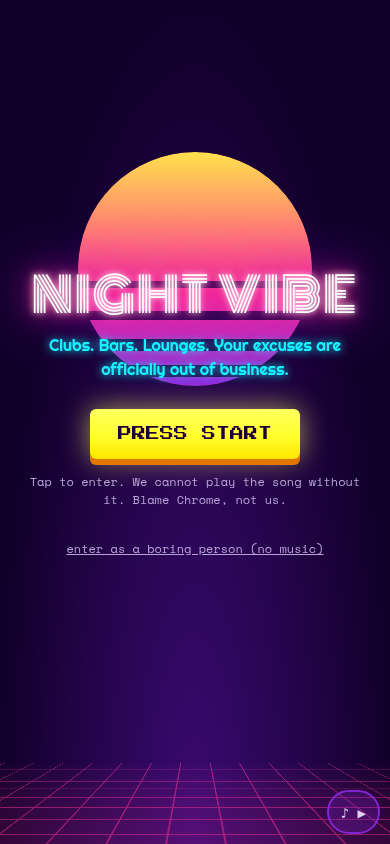
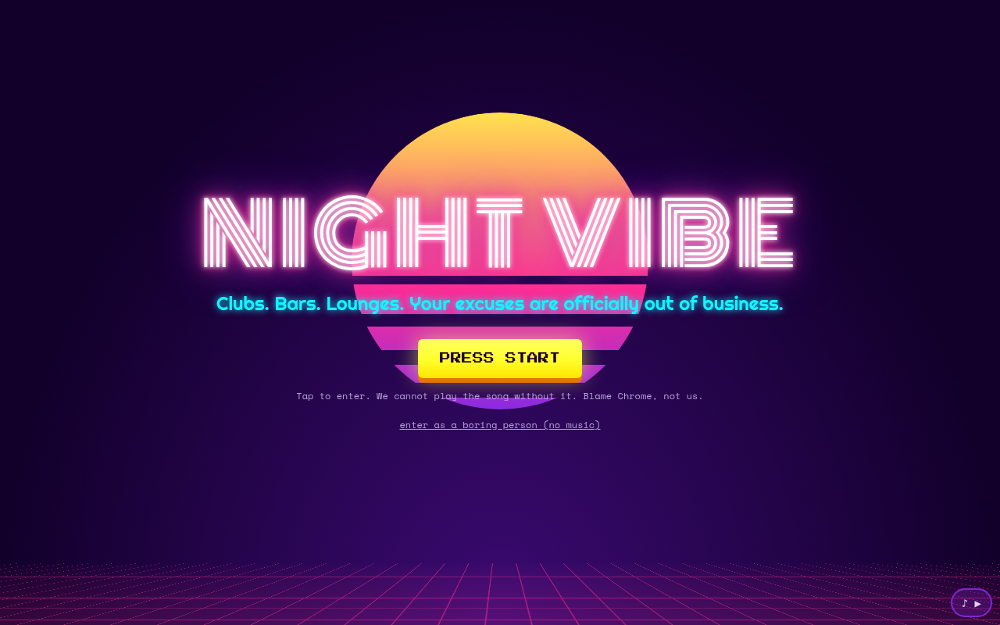

# NIGHT VIBE

**Live:** https://night-vibe-6cy.pages.dev/

What is happening in your city tonight. Pick a city and get the clubs, bars and lounges on a map and a list, what events are on, where to stay, and the weather - wrapped in a retro synthwave start screen with its own song.

## Screenshots

| Mobile | Desktop |
| --- | --- |
|  |  |

## Features

- City search with chips for quick picks, venue data from OpenStreetMap (Overpass) shown on an interactive Leaflet map and as cards
- Tab bar: **Places / Events / Hotels / Weather** - each tab shows only its section
- Events from Ticketmaster Discovery when an API key is set, otherwise curated link-outs per city (Kassir, Biletix, Yandex Afisha and more)
- Hotels box (Booking search links) and a live weather box (Open-Meteo)
- 4 languages: English, Arabic (RTL), Turkish, Russian
- Plan-your-night builder and a share card for sending the plan to friends
- Theme song (configurable YouTube embed in `config.js`)
- SEO basics: Open Graph image, robots.txt, sitemap.xml, JSON-LD

## Stack

Vanilla HTML/CSS/JS. No build step, no backend.

- `index.html`, `style.css`, `app.js` - the app
- `strings.js`, `strings2.js` - translations (EN/AR/TR/RU)
- `config.js` - the song and the optional Ticketmaster key (empty = link-out mode)
- `lib/` - Leaflet (map library)

Data sources: Overpass API (venues), Nominatim (geocoding), Open-Meteo (weather), Wikimedia Commons (city photos), Ticketmaster Discovery (optional events).

## Run it

It is a static site: serve the folder with anything and open it.

```bash
npx serve .        # or python3 -m http.server
```

The live copy is hosted on Cloudflare Pages.

## Credit

Built by Davinci with Instinct (AI assistant), November 2026.
